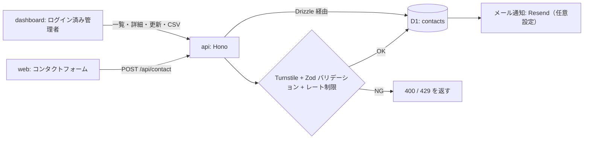

# Astro モノレポ・ボイラープレート計画（確定版）

- 作成日: 2026-11-04（同日、決定事項をすべて確定して確定版とした）
- 状態: **計画確定。§9 の決定事項 D1〜D19 はすべて確定済み、詳細実装仕様とチケット別実装計画は別ファイルの実装計画書に分離。実装はユーザー側で実施する**（2026-11-04 決定）。リポジトリ作成・GitHub への反映も未実施
- ライセンス方針: MIT で公開
- 表記について: 依頼文の「Context Collection」は、Astro 公式名称の **Content Collections** として計画する

---

## 1. 目的

Astro のウェブサイトと、問い合わせを管理するダッシュボードを1つのモノレポにまとめた、再利用可能なボイラープレートを作り、MIT ライセンスで公開する。

想定する利用者（v1 の主対象）:

- 小規模事業者・個人事業主のコーポレートサイト／店舗サイトを Astro で作る人
- フォーム送信を外部 SaaS に依存せず、自分で管理したい人
- 「サイト本体は静的に近く軽く、問い合わせデータだけを安全に扱う」構成の出発点が欲しい開発者

狙いは、機能を盛ることではなく、**clone して設定を差し替えれば、そのまま実サイトとして運用開始できる最小構成**にすること（作成 CLI は後日導入。D16）。

## 2. 前提 — 新規発明ではなく、実績パターンの一般化

ゼロから設計しない。すでに本番で動いている2つのモノレポの型を、個人情報・固有設定を取り除いて汎用化する。

| 実績 | 取り込む型 |
|---|---|
| `engineer-ba-sulto/engineer-ba-sulto`（本番 Bun workspaces モノレポ） | `apps/*`（複数 Astro + api）／ `packages/ui` が `.astro` コンポーネントを subpath exports で配る型／ `packages/contact-form`（純粋 TS + `bun test`）／ `packages/auth`・`site-config`・`content-schema`・`analytics` の分割 |
| `kurashiwake`（Astro + Cloudflare Workers） | Astro + `@astrojs/cloudflare`、`output: "server"` + 記事ルートは `prerender`、Content Collections（`src/content.config.ts`、カテゴリフォルダ + pages コレクション）、依存を最小に保つ方針、GA4 の型付きイベント |
| 小規模店舗 HP 事業（Cloudflare + Astro、月額なし） | 「月額固定費を増やさない」ことが価値になる利用者像。DB・ホスティングも無料枠で完結する構成を既定にする |

したがって技術選定の原則は「実績のある型から外れない。外れる場合は理由をこの計画に書く」。

## 3. スコープ

### v1 に入れるもの

**ウェブサイト（apps/web）**

- **フロントエンドは LP 1ページ構成**（D13。2026-11-11 の D17 で配布物の仕様に復帰し、フォーム一式のみとした D14 を置き換えた）。本体は `/` のみで、フォームは LP 内のセクションに組み込む。送信完了（`/contact/thanks/`）とポリシー2ページ（`/privacy/` `/terms/`）は別ページとする（D18、§6.2）
- 記事・お知らせ機能は v1 に**入れない**（Content Collections は使わない）
- コンタクトフォームは完成品として同梱する（バリデーション、スパム対策、送信中・エラー・完了の状態表示）。利用者はこのフォームを自分のサイトへ組み込むか、そのまま使う
- SEO 最小装備: title / description / OGP、JSON-LD（構造化データ: 事業者情報 LocalBusiness と、LP の FAQ から生成する FAQPage。2026-11-11 ユーザー指示で追加）、sitemap、robots.txt、404（RSS は記事を外したため作らない）

**ダッシュボード（apps/dashboard）**

- 認証は Cloudflare Access（管理者のみ。アプリ内にログイン画面は作らない。D4 確定、§8）
- 問い合わせ一覧（未読バッジ、検索、ステータス絞り込み、ページネーション）
- 問い合わせ詳細（本文、メタ情報、管理メモ）
- ステータス変更: `new`（新規）→ `in_progress`（対応中）→ `done`（完了）／ `spam`
- CSV エクスポート、削除（論理削除を既定、完全削除は明示操作）

**API（apps/api）**

- フォーム受付エンドポイント、ダッシュボード用 CRUD エンドポイント
- バリデーション、Turnstile 検証、レート制限、メール通知（Resend、§7.5）

### v1 に入れないもの（明記して公開する）

- EC、予約、会員登録、決済
- 複数管理者・権限ロール（管理者は1人前提。必要になれば v2）
- 多言語化（構造だけ妨げない）
- 記事・お知らせ機能そのものと、CMS のようなブラウザ上でのコンテンツ編集
- メールマーケティング、自動返信の高度なシナリオ

## 4. 推奨スタック

| 層 | 推奨 | 理由 |
|---|---|---|
| ランタイム / パッケージ管理 | Bun（workspaces、`bun test`） | 両実績モノレポと同一。テスト標準も統一できる |
| 言語 | TypeScript（strict） | 実績どおり |
| ウェブサイト | Astro（着手時点で最新安定版に固定）+ `@astrojs/cloudflare` + Tailwind CSS v4 | 配布物は LP 1ページ構成（D17）。ページは静的生成とし、フォーム送信はクライアントから apps/api へ直接 POST する（web 側にサーバー処理は持たない）。CSS は Tailwind で dashboard と書き方を統一する（2026-11-09 決定。React は web に入れない） |
| ダッシュボード | Astro（SSR のみ、別アプリとして分離）+ shadcn/ui（React + Tailwind CSS。2026-11-09 D5 改訂） | 認証境界とデプロイをサイト本体から分ける。ページ構成とデータ取得は Astro SSR のまま、shadcn/ui の部品は操作部品の React island として埋め込む（§9 D5） |
| API | Hono on Cloudflare Workers（別デプロイ） | `kurashiwake` の apps/api と同型 |
| DB | **Cloudflare D1 + Drizzle ORM**（2026-11-04 確定。旧 D3 の推奨「素の SQL」から変更） | 月額なし、Workers と同一基盤。**D1 バインディングを持つのは apps/api のみ**（§7.1）。テーブル定義は Drizzle スキーマを正とし、マイグレーションは drizzle-kit で生成して `wrangler d1 migrations` で適用 |
| バリデーション | **Zod**（2026-11-04 確定）。入力スキーマを `packages/contact-form` で一元化し、フォーム・API・ダッシュボードで共有。API 側は `@hono/zod-validator` で検証 | 実績パッケージの型そのもの。Drizzle スキーマ（DB の形）と Zod スキーマ（入力の形）は役割が別なので分けて持ち、重なる部分は `drizzle-zod` で橋渡しする（§7.4） |
| アクセス解析（apps/web のみ） | **Google Analytics 4 + Cloudflare Web Analytics を併用**（2026-11-04 確定） | 役割分担: Cloudflare は Cookie レスのページビュー計測、GA4 はイベント計測（フォーム送信完了など。型付きイベントは `packages/analytics`、kurashiwake の型付き GA4 ヘルパーの型）。**どちらも ID / トークン未設定ならスクリプト自体を出力しない**。dashboard と api には入れない（管理画面を計測しない、個人情報をイベントに載せない） |
| Lint / Format | **Biome をプロジェクト全体に導入**（2026-11-04 確定。着手時点の最新は v2.6 系）ルートに `biome.json` を置き、ESLint / Prettier は使わない | 1ツールで lint + format + import 整理が完結し、Bun 環境とも相性がよい。対象は TS / JS / JSON / CSS を主とする。`.astro` は Biome の対応範囲が限られるため、対応外の部分に無理に適用しない運用を T2 で検証して決める。なお VoidZero の Vite+（Oxlint / Oxfmt）は同領域の競合候補として D9 で検討し、併用はしない（フォーマッタの二重化はしない）。**ドメイン設定（T2 で有効化）**: Biome にはフレームワーク／ライブラリ別のルール群「ドメイン」があり、このスタックに直接効くものが2つある — `astro` ドメイン（set: ディレクティブ関連の Astro 固有ルール。現状は全て nursery のため、有効化範囲は T2 で判断）と `drizzle` ドメイン（`noDrizzleDeleteWithoutWhere` / `noDrizzleUpdateWithoutWhere`、どちらも recommended。WHERE なしの削除・更新を止める安全ルールで、問い合わせデータの誤削除防止に直結する）。出典: https://biomejs.dev/linter/domains/（2026-11-04 確認） |
| スパム対策 | Cloudflare Turnstile + honeypot + サーバー側レート制限 | 無料、外部 SaaS 不要 |
| メール通知 | **Resend**（2026-11-04 確定）。送信処理は apps/api 内に置き、内部は差し替え可能な薄いラッパーにする。API キー未設定なら送信をスキップし DB 保存のみで動作 | 管理者への着信通知が主目的。DB 保存が正で、メールは通知手段にすぎない（§7.5）。clone 直後でもメール契約なしで動くことが公開ボイラープレートの条件 |
| デプロイ | **Cloudflare Workers のみ**（Pages は使わない。2026-11-04 明示）。web・dashboard・api を個別に `wrangler deploy`、設定は `wrangler` | kurashiwake 本番と同一（Workers 運用） |
| CI | GitHub Actions: **Biome check**、型チェック、`bun test`、全アプリ build | MIT 公開物として「壊れていない」証跡になる |

## 5. モノレポ構成案

```
<repo-name>/                  # 名称は §9 D1 で決定
├── apps/
│   ├── web/                  # ウェブサイト（Astro、LP 1ページ + 送信完了 + ポリシー2点。D13 / D17 / D18）。レイアウト・共通コンポーネントもこのアプリ内に置く（D11）。GA4 + Cloudflare Web Analytics はここだけ
│   ├── dashboard/            # 管理ダッシュボード（Astro SSR、要認証）。D1 には直接つながず API 経由
│   └── api/                  # Hono on Cloudflare Workers。D1 バインディングはこのアプリだけが持つ
│       ├── src/db/           # Drizzle スキーマと接続（drizzle(env.DB)）
│       ├── drizzle/          # drizzle-kit が生成するマイグレーション
│       └── drizzle.config.ts
├── packages/
│   ├── contact-form/         # 純粋 TS: Zod スキーマ、型、バリデーション、整形。bun test 対象
│   ├── site-config/          # サイト名・URL・説明・連絡先など「差し替え箇所」の一元管理
│   ├── auth/                 # Cloudflare Access の JWT 検証ヘルパー（dashboard / api 共用。ログイン実装は持たない）
│   └── analytics/            # GA4 の型付きイベント定義（未設定で無効。計測 ID 本体は .env）
├── docs/
│   ├── setup.md              # セットアップ手順（clone → デプロイまで）
│   ├── customization.md      # 差し替え箇所ガイド（site-config、ポリシー文面、配色）
│   └── architecture.md       # 構成とデータフロー
├── .env.example              # 値なしの雛形のみ（GA4 測定 ID、CF Analytics トークン、RESEND_API_KEY 含む）
├── biome.json                # Biome 設定（プロジェクト全体、ルートに1つ）
├── LICENSE                   # MIT
├── README.md                 # 概要、クイックスタート、スクリーンショット
├── SECURITY.md               # 脆弱性報告先と、フォームを公開する際の注意
└── CONTRIBUTING.md
```

ルール:

- パッケージは生 TS / `.astro` を exports で配り、ビルド工程を挟まない（実績の型）
- アプリ間の直接 import は禁止。共有は必ず `packages/*` 経由
- **D1 に接続するのは apps/api だけ**。web は DB に触れず、dashboard も D1 バインディングを持たず API 経由で読み書きする（理由は §7.1）
- サイト固有値（サイト名、メールアドレス、計測 ID 等）は `packages/site-config` と `.env` 以外に書かない

## 6. ウェブサイト仕様（apps/web）

### 6.1 apps/web（LP）の構成（D13、2026-11-11 D17 で配布物の仕様に復帰。フォームの置き場所は 2026-11-16 D19 で変更）

配布物（v0.1.0）の apps/web は LP 1ページ構成とする（D17 で D14 の「フォーム一式のみ」を置き換え、D13 の形に戻した）。フォームは LP には載せず、独立ページ `/contact/` に置く（D19、2026-11-16）。LP からはボタンで `/contact/` へ誘導する。

LP の本体は `/` の1ページとする（フォームは含まない）。Content Collections は使わない（記事・お知らせ機能を v1 から外したため）。

LP のセクション（上から順に）:

1. ヘッダー（サイト名、セクションへのアンカーリンク、問い合わせボタン）
2. ヒーロー（見出し、短い説明、問い合わせへのボタン）
3. 特徴・サービス（3項目程度）
4. 進め方・流れ（3〜4ステップ）
5. よくある質問（FAQ、3〜5問）
6. 会社・店舗概要（名称、所在地、電話、営業時間、対応エリアの表）
7. お問い合わせへの導線（見出しとボタン。リンク先は `/contact/`。フォーム本体は LP に置かない）
8. フッター（ポリシー2ページへのリンク、著作権表示）

- セクションの文面は `packages/site-config` の値と LP 内の固定文で持ち、利用者が書き換える場所を docs に明記する
- サンプル文面は、実在の事業者と誤認されないダミーと分かる内容にする
- ポリシー2点（§6.2）は LP とは別ページのままにする。フォームは独立ページ `/contact/`、送信完了は別ページ `/contact/thanks/` とする

### 6.2 ポリシーページ（2ページを静的ページで同梱。D18 で復活、2026-11-11）

文面作成の参考は **kiyaku.jp（https://kiyaku.jp/index.html）** とする（2026-11-04 指定）。Web サイト用の利用規約・プライバシーポリシー等の無料ひな型を掲載しているサイトで、個人・法人を問わず無料、商用利用可、コピペ・編集・改編自由、申請不要（同サイト「ご利用の際の注意事項」、2026-11-04 確認）。

| ページ | パス | 備考 |
|---|---|---|
| プライバシーポリシー | `/privacy/` | フォームで取得する項目、利用目的、第三者提供、開示請求の窓口を明記する雛形 |
| 利用規約 | `/terms/` | サイト閲覧・フォーム利用の範囲のみ。サービス規約ではない |
| （統合）クッキーと外部送信 | プライバシーポリシー内の一節 | 独立ページにせず、プライバシーポリシーの中の一節として開示する。GA4 を使う構成では Cookie と外部送信先（GA4、Cloudflare、Turnstile、Resend 等）の開示が必要なため、節としては必須とする |
| （対象外）特定商取引法に基づく表記 | — | 既定の同梱から外す。この表記はネット上で販売する場合に必要になるもので、このボイラープレートには EC・決済がないため。販売を行う利用者向けに、docs へ「必要なら kiyaku.jp の雛形で追加する」旨を記載する |
| お問い合わせについて | LP のフォームセクション内 | 返信目安、個人情報の扱いへの同意チェックと連動 |

- すべて「雛形であり法的助言ではない」旨を README と各ページ管理メモに明記する。そのまま使わず実態に合わせて修正すること、必要に応じて法律の専門家へ相談することもあわせて明記する（同梱しないことにした D15 の懸念への対処は、この明記と docs の案内で行う）
- ポリシー側の「取得項目」は §7 のフォーム項目定義と**単一の情報源**で一致させる（項目を変えたらポリシーも直す運用を docs に明記）
- プライバシーポリシー雛形には §6.4 のアクセス解析（GA4 / Cloudflare Web Analytics の利用と、GA4 の Cookie 利用）も記載項目に含める
- kiyaku.jp の使い方の線引き: 同梱文面は、kiyaku.jp のひな型を**参考にして、このボイラープレートの実態（フォーム項目、GA4 / Cloudflare Web Analytics、Turnstile、Resend）に合わせて書き起こす**。同サイト自体も「ひな型は一例であり、実態に合わせて追加・修正・削除すること」「法令が反映されていない場合がある」と注意しているため、その注意は README / customization.md にも転記する
- **README にも kiyaku.jp を推奨参考として記載する**（利用者向け）: 「ポリシー文面の見直しには kiyaku.jp のひな型が参考になります」旨と URL を、README のポリシー関連の節と `docs/customization.md` の両方に入れる
- 注意: kiyaku.jp のひな型の利用条件は「自分のサイトへの利用（コピペ・改編）」を想定したものと読めるため、ひな型本文をそのまま丸ごと転載して MIT の対象であるかのように再配布する形にはしない。同梱文面は上記のとおり実態に合わせて書き起こしたものとし、出典・参考として kiyaku.jp へのリンクを README に残す

### 6.3 コンタクトフォーム

項目（v1 固定）: 名前（任意。2026-11-09 に必須から変更。理由: 情報漏洩時に被害を最小にするため、収集する個人情報を最小限にする）、メールアドレス（必須）、件名カテゴリ（任意・選択式）、本文（必須）、プライバシーポリシー同意（必須チェック。リンク先は同梱の `/privacy/`。§6.2）

- クライアント側は即時バリデーション表示のみ。**最終判定は API 側**（共有 Zod スキーマで再検証）
- 状態: 送信中は二重送信防止、失敗時は入力を保持して再送可、完了は `/contact/thanks/` へ遷移
- Turnstile はサイトキー未設定時は無効化でき、ローカル開発が止まらないようにする
- デモ公開用に **デモモード** を持つ（D8）: API 側の環境変数が有効な間は、バリデーションを通しても D1 保存と Resend 通知を行わず、完了だけを返す

### 6.4 アクセス解析（apps/web のみ、2026-11-04 確定）

GA4 と Cloudflare Web Analytics を併用し、apps/web 内のレイアウト（`src/components/Analytics.astro`）から読み込む。

| ツール | 役割 | 設定値（.env） |
|---|---|---|
| Cloudflare Web Analytics | Cookie レスのページビュー計測（軽量、まずはこちらで全体を見る） | `PUBLIC_CF_WEB_ANALYTICS_TOKEN` |
| Google Analytics 4 | イベント計測: フォーム送信完了、主要 CTA クリック等。イベント定義は `packages/analytics` の型付きヘルパー経由でのみ送る | `PUBLIC_GA4_MEASUREMENT_ID` |

- どちらも**未設定ならタグ自体を出力しない**（fork した利用者が計測を契約する前に余計な送信をしない）
- dashboard・api には入れない（管理画面の操作を計測しない）
- イベントにフォームの入力内容・メールアドレス等の個人情報を絶対に載せない（kurashiwake の GA4 運用と同じ規律）

## 7. API とデータ（apps/api + D1）

### 7.1 データフロー — D1 に接続するのは apps/api だけ



**接続の置き場所は api に一本化する（2026-11-04 確定）。** apps/api の `wrangler` 設定だけが D1 バインディング（`DB`）を持ち、接続は `drizzle(env.DB)` で行う。

- web から D1 へ直接つながない: フォーム送信は必ず API を通す。Turnstile・バリデーション・レート制限を1か所に集約するため
- dashboard からも D1 へ直接つながない: 技術的には Astro SSR からもバインディングは可能だが、やらない。読み書きのロジックが api と dashboard に二重化すること、§8.1 の「dashboard は表示層に徹し、差し替え可能に保つ」規律が崩れることが理由。dashboard は管理用エンドポイント（§7.3）を呼ぶだけにする
- 効果: DB の接続情報とクエリ実装の置き場所が1か所になり、認証チェックも API 側で一元化できる

### 7.2 `contacts` テーブル（確定）

確定仕様は実装計画書 §1.3。要点のみ再掲する（旧案の UUID 主キー・ISO 文字列の時刻・`read_at` は採用しない）。

| カラム | 型 | 備考 |
|---|---|---|
| id | INTEGER | 主キー（AUTOINCREMENT） |
| name / email / category / message | TEXT | フォーム項目と1対1（本文のカラム名は `message`） |
| status | TEXT | `new` / `in_progress` / `done` / `spam`、既定 `new` |
| admin_note | TEXT | 管理メモ。フォーム送信者には見えない |
| ip_hash | TEXT | 生 IP は保存せずハッシュのみ（スパム対策用） |
| user_agent | TEXT | 不具合調査用 |
| created_at / updated_at / deleted_at | INTEGER（UNIX 秒） | 論理削除は deleted_at。表示時に JST へ変換 |

テーブル定義の正は、apps/api の Drizzle スキーマ（`sqliteTable`）とする。マイグレーションは drizzle-kit で生成し、`wrangler d1 migrations` で適用する手順を docs 化する。

### 7.3 エンドポイント（確定）

確定仕様（応答形・エラーコード・クエリ仕様）は実装計画書 §1.5。構成のみ再掲する。

- `GET /api/health` — 公開。死活確認
- `POST /api/contact` — 公開。Turnstile 必須（設定時）、レート制限あり。デモモード時は保存しない
- `GET /api/admin/contacts` — サービストークン必須。一覧（検索・絞り込み・ページング）
- `GET /api/admin/contacts/:id` — サービストークン必須。詳細
- `PATCH /api/admin/contacts/:id` — サービストークン必須。ステータス・管理メモ更新
- `DELETE /api/admin/contacts/:id` — サービストークン必須。論理削除
- `GET /api/admin/contacts/export.csv` — サービストークン必須。現在の絞り込み条件で CSV

### 7.4 Drizzle と Zod の役割分担

似た形を二重に持たないよう、担当を分ける。

| 対象 | 正とする定義 | 置き場所 | 使う側 |
|---|---|---|---|
| DB の形（テーブル、カラム、型） | Drizzle スキーマ | `apps/api/src/db/` | api のクエリ、drizzle-kit のマイグレーション生成 |
| 入力の形（フォーム送信、管理操作のリクエスト） | Zod スキーマ + `z.infer` の型 | `packages/contact-form` | web のフォーム、api の `@hono/zod-validator`、dashboard の送信前チェック |
| 両者の重なり（行の挿入・更新の形） | `drizzle-zod` で Drizzle スキーマから生成 | api 内 | api が Zod 入力を DB の形へ渡す境界でのみ使う |

ポイント: フォーム項目と DB カラムは一致しない（`ip_hash` や `admin_note` は送信者に触らせないサーバー専用項目）。だから入力 Zod を DB スキーマから機械生成はせず、手で分けて持つ。生成で賄うのは api 内部の境界だけにする。

### 7.5 メール通知 — Resend（2026-11-04 確定）

- 送信主体は **apps/api**（フォームを受け取る側）。送信処理は Resend 専用の薄いラッパー（`apps/api/src/mail/`）に閉じ込め、本体ロジックから直接 Resend を呼ばない
- v1 の通知は**管理者宛の着信通知のみ**。送信者への自動返信は v1 に入れない（送る場合は別途判断。安易に自動返信を付けるとスパムの踏み台になるため）
- 設定値（すべて apps/api のシークレット／環境変数。web・dashboard に置かない）:
  - `RESEND_API_KEY` — 未設定なら通知をスキップし、DB 保存のみで正常動作（ローカル開発・未契約時の既定）
  - `CONTACT_NOTIFY_TO` — 管理者の受信アドレス
  - `CONTACT_FROM` — 送信元。独自ドメインを使うには Resend 側でドメイン認証（SPF / DKIM）が必要。その手順を setup ドキュメントに明記する。認証前の `onboarding@resend.dev` は開発・動作確認用のみで、本番では使わない
- 文面はプレーンテキスト + 最小の HTML の2形式。React Email 等の追加フレームワークは入れない。件名の型: `[<サイト名>] 新しいお問い合わせ（<カテゴリ>）`、本文に問い合わせ内容とダッシュボード詳細へのリンクを含める。`Reply-To` には送信者のメールアドレスを設定し、管理者はそのまま返信できるようにする
- **失敗時の扱い: メール送信が失敗してもフォーム送信は成功として扱う。** 正は D1 への保存であり、メールは通知にすぎない。失敗は API のログに残す（リトライ機構は v1 では持たない）

## 8. ダッシュボード仕様（apps/dashboard）

画面: 一覧 / 詳細（1画面でステータス変更・メモ保存・削除まで完結させる）。**ログイン画面は作らない（2026-11-04 確定）**

認証と利用者は次のとおり固定する:

- **Cloudflare Access で dashboard のドメイン全体を保護**し、許可ポリシーは管理者のメールアドレスの許可リストのみ。利用者は管理者だけで、一般ユーザーは入らない前提の画面である
- アプリ側は Access が付与する JWT（`Cf-Access-Jwt-Assertion`）を `packages/auth` のヘルパーで検証し、管理者のメールアドレスを取得する（Access をすり抜けた直接アクセスへの多層防御）
- **API の管理用エンドポイント（`/api/admin/*`）も無防備にしない**: Access のサービストークンを dashboard のサーバー側だけが保持し、API 呼び出しに付与する。ブラウザから API を直接叩く作りにはしない（dashboard の SSR 経由に統一）

- 一覧の初期表示は「未完了（new + in_progress）」が既定、件数バッジ付き
- 検索対象: 名前、メールアドレス、本文
- スマホでも最低限操作できるレスポンシブ（管理者は外出先で新規着信だけ確認する想定）
- ダッシュボードは `noindex` + 認証必須を既定とし、web 側 sitemap に含めない
- 操作ログは v1 では持たない（管理者1人前提のため。§3 の v1 外に明記）

### 8.1 ダッシュボードに Astro が最適か（2026-11-04 検討を追記）

結論: **単体評価では「アプリ専用フレームワークの方が自然」だが、このモノレポの v1 条件では Astro が最適**、という条件付きの最適。**2026-11-04 に「認証は Cloudflare Access を使う」「利用者は管理者のみ」という前提が確定したことで、この条件付き最適は確定に変わった（D4 / D5）。**

ダッシュボード単体で比べた場合の率直な評価:

| 候補 | ダッシュボード適性 | この計画で採らない理由 |
|---|---|---|
| SvelteKit | フォームアクション・データロード・状態管理までアプリ前提で揃い、単体では最も自然 | モノレポに第2のフレームワークが入り、site-config 等のパッケージ共有の前提が崩れる。保守対象が2系統になる |
| Next.js | 管理画面のエコシステム（表、UI 部品、認証ライブラリ）が最大 | 重い。Cloudflare へのデプロイに追加の適合層が要り、「依存最小・月額なし」のボイラープレートの性格と逆行する |
| Hono のみ（API と一体） | Workers ネイティブで最小。API と認証を1か所にできる | 画面側のレイアウト・資産管理・アセット配信が弱い。管理画面としての作り込みを自前で抱える |
| **Astro（SSR）** | 一覧・詳細・フォーム送信といった**サーバー主導の CRUD には十分**。ページ単位で完結し、JS 配信が最小 | —（採用） |

Astro が苦手な領域も明記する: リアルタイム更新、楽観的 UI を伴う一括編集・インライン編集の多いデータグリッド、複数管理者と権限、グラフ中心の分析画面。これらが要件になった時点で Astro は最適でなくなる。

そのため v1 は次の2条件を設計規律として固定し、「Astro で困らない範囲」にダッシュボードを収める:

1. **サーバー主導に徹する**: 検索・絞り込み・ページング・ステータス変更はすべてサーバー側（API 経由）で行い、クライアントに業務状態を持たせない。対話部品（ダイアログ・セレクト・トースト等）は shadcn/ui の React island として埋め込む（2026-11-09 の D5 改訂）。island は表示と操作の受け口に限り、データの取得・更新は従来どおり dashboard のサーバー経由で行う
2. **差し替え可能性を保つ**: 業務ロジックはすべて `packages/contact-form` と `apps/api` 側に置き、dashboard は「API を呼んで表示するだけ」の層にする。この境界が守られていれば、将来 SvelteKit 等へ移す場合も dashboard アプリ単体の差し替えで済み、web・api・DB は無傷で残る

### 8.2 apps/dashboard に Void を採用する案（2026-11-04 評価）

結論: **§8.1 の回答（Astro が条件付きで最適）は変わらない。変わるのは認証・データ・デプロイの層の評価で、Void の位置づけが「一般的な様子見」から「D4 がアプリ内認証に翻した場合の第一候補」へ上がる。**

- Void は UI フレームワークではない。Astro 等のメタフレームワークと統合し、描画はそちらに任せて、リソース API（Hono）、マイグレーション、デプロイ、認証（Better Auth）を担う層である。したがって Void 採用は Astro と競合せず、組み合わせる話になる
- dashboard 限定で見た場合の利点: (1) 未決の D4（認証）への答えが Better Auth として付いてくる、(2) D1 バインディングの自動プロビジョニングとマイグレーション適用で、dashboard のデプロイ手順が短くなる、(3) 影響範囲が内部ツール1アプリに閉じ、web 本体に波及しない
- それでも v1 で採用しない理由: (1) **「dashboard だけ」では閉じない** — Void の流儀では dashboard 側がリソース API と D1 バインディングを持つことになり、「D1 接続は apps/api のみ」という確定事項と衝突する。Void を入れるなら apps/api の役割ごと再設計になり、フォーム受付（web 側）にも波及する、(2) 個人情報（問い合わせデータ）を扱う最もセンシティブなアプリに、発表から数週間の基盤を据えるのはリスクの順序が逆、(3) 型安全は既に Drizzle + Zod で確保済みで、Void の「DB から UI まで型安全」と重なる
- したがって扱いは条件付き候補とする: D4 が Cloudflare Access 前提のままなら Void は不要。アプリ内認証へ翻す場合のみ、T11（dashboard 実装）の前に Void + Better Auth のスパイク検証を行う
- **決着（2026-11-04）: D4 は Cloudflare Access で確定したため、この条件付き候補は不採用で閉じる。** Void の残る再検討トリガーは T14（手順の複雑さ）のみとする（D10）

## 9. 決定事項（D1〜D19、すべて確定済み）

推奨を先に置く。各項目、推奨で進めてよければ一括確定できる。

| ID | 論点 | 推奨 | 代替案と影響 |
|---|---|---|---|
| D1 | リポジトリ名 | **確定（2026-11-04）: `astro-site-dashboard-boilerplate`**（オーナー: engineer-ba-sulto）。Astro / サイト / ダッシュボード / ボイラープレートと中身のキーワードがすべて入る名前を、検索で見つけやすさ優先で採用。付随決定: パッケージのスコープはリポジトリ名と切り離し **`@repo/*` に固定**する（`@repo/contact-form` 等）。利用者が自分のスコープへ変える手順は `docs/customization.md` に書く | `astro-business-site-boilerplate`（dashboard が落ちる）、`astro-monorepo-starter`（中身が伝わらない）、`astro-site-kit`（有料製品 AstroKit と紛らわしい）は不採用 |
| D2 | 主対象と README 言語 | **確定（2026-11-04）: 主対象は国内の小規模事業サイト制作者**（店舗・小規模法人のサイトを作る人。自身の HP 制作事業での再利用を含む）。**README は日本語を正とし、冒頭に英語要約は置かない**（サイトと dashboard の UI 表記も日本語が既定）。GitHub のリポジトリ説明文と topics は、README とは別に英語で付けてよい | 英語正にすると海外利用は広がるが、想定利用者の一次ニーズ（ポリシー雛形等）とずれる。当初推奨にあった「冒頭に英語要約」は、ユーザーの修正により付けないことにした |
| D3 | DB アクセス層 | **確定（2026-11-04）: D1 + Drizzle ORM + Zod**。接続は apps/api のみ、役割分担は §7.4 | 当初の推奨「素の SQL（依存最小）」は採らないことにした。型安全とスキーマの一元管理を優先する |
| D4 | ダッシュボード認証 | **確定（2026-11-04）: Cloudflare Access**。管理者のみが使う前提で、アプリ内認証・ログイン画面は作らない。Access の JWT 検証と API 用サービストークンの扱いは §8 | アプリ内認証にした場合の Void + Better Auth 候補（§8.2）は、この確定により不採用で閉じる |
| D5 | ダッシュボードのフレームワークと UI 実装 | **確定（2026-11-04）→ 改訂（2026-11-09）: Astro（SSR）は維持し、UI に shadcn/ui を採用する**。追加するのは dashboard のみへの `@astrojs/react` と Tailwind CSS で、フレームワークの乗り換えはしない。shadcn/ui の部品（テーブル・ダイアログ・セレクト・バッジ・トースト等）はコードを取り込む方式で `apps/dashboard/src/components/ui/` に置き、React island として操作部品に限定して使う。一覧の描画・検索・絞り込み・ページング・データ取得は Astro SSR + サーバー経由のまま（§8.1 規律1を改訂）。旧決定（vanilla TS、フレームワーク追加なし）はこの改訂で置き換える。**同日追加決定: Tailwind CSS は web にも採用し、CSS の書き方を web / dashboard で統一する**（v4、`@tailwindcss/vite`。React を web に入れる話ではない。api は UI がないため対象外）。デザイントークンの共通パッケージ化はせず、各アプリの CSS 変数で揃える | 代替候補（SvelteKit / Next.js / Vinext 等）への差し替え条件は §8.1 の規律2（表示層に徹する）が守る |
| D6 | content-schema の共有範囲 | スキーマは web 内に置き、`packages/content-schema` は作らない（dashboard は記事を扱わないため）。**2026-11-09 追記: D13 で記事機能自体を外し Content Collections を使わなくなったため、この論点は前提消滅。以後は記録として残す** | 将来 dashboard で記事管理をするなら共有化が必要。その時点で切り出す |
| D7 | メール通知 | **確定（2026-11-04）: Resend**。管理者宛の着信通知のみ、送信者への自動返信は v1 外。詳細は §7.5 | — |
| D8 | デモサイト | **確定（2026-11-04）: A。2026-11-11 追記: D17 で LP が配布物に戻ったため、デモは配布物の LP そのもののデプロイとする**。v1.0 公開時に配布物の LP をデモとして公開し、dashboard はスクリーンショットで見せる（触れる dashboard デモは作らない）。条件: (1) デモは v0.1.0 の公開条件に含めない（公開を遅らせない）、(2) デモのフォームは**デモモード**とする — API 側の環境変数で切り替え、送信を受けても D1 に保存せず Resend 通知も送らず、完了画面だけ返す、(3) デモ用デプロイは本番用と設定を分け、データはダミーのみ | B（デモなし）/ C（dashboard も触れるデモ）は不採用。C は Access を外した読み取り専用デプロイと書き込み抑止の分岐が、デモのためだけの実装になるため |
| D9 | ツールチェーン | **確定（2026-11-04）: A = Biome でいく**。Vite+（VoidZero）全面採用（C）も、Oxlint + Oxfmt 単体への差し替え（B）も採らない。根拠: (1) この規模では Vite+ の追加価値（Vitest 統合、タスクキャッシュ、ランタイム管理）が必要薄く、`bun test` は本番モノレポの実績標準、(2) Biome（最新 v2.6 系）にはこのスタック固有のドメインがある — `drizzle` ドメインの WHERE なし削除・更新を止める recommended ルールは問い合わせデータの誤削除防止に直結し、`astro` ドメイン（nursery）も存在する、(3) Void を v1 で採用しない以上、生態系シナジーは効かない。再評価は Void 採用が現実になった時点で行う（lint / format 層の差し替えコストは低い） | B / C は不採用として記録のみ残す。Biome と Oxc 系の併用はしない |
| D10 | Cloudflare 発表の3製品（Void / Vinext / EmDash）の採否（2026-11-04 評価） | **v1 ではいずれも採用しない。とくに EmDash を apps/dashboard に使うのではない**（EmDash の管理画面は CMS のコンテンツ編集用であり、問い合わせ管理の機能を持たない。dashboard は従来どおり自作の Astro SSR アプリとする）。3製品は層が違い、競合ではなく役割が異なる（Void=デプロイ／フルスタック基盤、Vinext=Next.js 系フレームワーク、EmDash=Astro ベース CMS）。現計画（Astro + Hono + D1/Drizzle/Zod + wrangler）はいずれとも正面では重ならないが、3製品とも 2026 年発表で変化が速く、他人が土台にする公開ボイラープレートの基盤に据えるにはリスクが高い。再検討のトリガーは右欄 | 再検討トリガー: EmDash = 利用者からブラウザでの記事編集の要望が出たら（v2 の CMS 化候補。ただし管理画面が EmDash 側と自作 dashboard で二重化する問題を先に解く）。Void = T14 の再現テストでセットアップ／デプロイ手順の複雑さが実際に障壁になったら（認証目的の候補は D4 の Access 確定により消滅）。dashboard 限定採用の評価は §8.2。Vinext = dashboard を React / Next.js 系へ翻す判断が先にあった場合のみ |
| D11 | UI コンポーネントの置き場所（2026-11-04 改訂） | **`@repo/ui` は v1 に作らない（確定）**。SiteLayout / Header / Footer / Analytics / ContactForm はすべて **apps/web 内**（`src/layouts/`・`src/components/`・`src/styles/`）に置く。根拠: 使うアプリが web だけで、dashboard とは共有しない。主対象（1サイト運用の制作者）が最も頻繁にカスタマイズする場所であり、共有パッケージ経由は exports の理解という摩擦だけが残る。パッケージに残すのは実際に複数が使うもの（contact-form / site-config / auth / analytics）に限る | 2つ目のサイト系アプリ（LP 等）を足すことになったら、その時点でコンポーネントを `@repo/ui` へ移す（移設コストは小さい） |
| D12 | Cloudflare の新 CLI `cf` の採否（2026-11-09 検討） | **使わない（確定）。CLI は wrangler のまま**。理由: (1) `cf` は 2026-09-28 開始のオープンベータで、安定版の時期が未発表、(2) 公式要件で **Bun はサポートされず**（`cloudflare.config.ts` の読み込みが Node のモジュール読み込み依存で、Bun 上では失敗する）、この計画の「Bun で統一、Node は使わない」と衝突する、(3) ベータ期間中は **Astro 6 以降が `cf` でビルドできない**と公式ドキュメントに明記があり、この計画の Astro 7 系が対象になる。移行自体は `cf migrate` で機械的にできるため、必要になった時点で困らない | 再検討トリガー: `cf` の安定版が出て、Astro（現行メジャー）のビルド対応が入った時点。その際 Bun 対応の有無も併せて確認する |
| D13 | フロントエンドの形（2026-11-09 ユーザー指示 → 2026-11-11 D14 で位置づけ変更） | **LP 1ページ構成（配布物の仕様。2026-11-11 の D14 で一時「フロントエンド例」の仕様に格下げされたが、同日の D17 で配布物の仕様に復帰）**。本体は `/` のみで、会社概要とお問い合わせフォームも LP 内のセクションに統合する。記事・お知らせ機能と Content Collections は使わず、RSS も作らない。ポリシー2ページを同梱する（D18）。詳細は §6.1、§6.2 | 記事機能が必要になったら v2 で Content Collections ごと追加する（kurashiwake の実績パターンがそのまま使える） |
| D14 | 配布物のフロントエンドの範囲（2026-11-11 ユーザー決定） | **配布物（v0.1.0）の apps/web はお問い合わせフォーム一式のみとする**。ページは `/contact/` と `/contact/thanks/` だけ（ポリシー文面は D15 で同梱しないことにした）。LP やトップページは配布物に入れない。理由: 使う人がフロントエンドを自由に作れるようにし、デザインの好みで使われなくなる事態を避ける —— **この決定は同日の D17 で置き換えられた（LP 形に復帰）。経緯の記録として残す** | フォームの配置先（サブドメイン／自サイトのパス配下）は利用者が選ぶ。接続手順は docs に両パターンを書く |
| D15 | ポリシー文面の同梱（2026-11-11 ユーザー決定） | **プライバシーポリシー・利用規約等の文面は配布物に含めない** —— **この決定は同日の D18 で置き換えられた（ポリシー2ページを同梱に復活）。経緯の記録として残す**。理由: 雛形をそのまま使われてしまう恐れがあるため。同日に決めた「4ページ→2ページへ削減」を置き換える。代わりに、同意チェックのリンク先を利用者のポリシー URL の設定値（site-config の `privacyPolicyUrl`、本番ビルドで未設定を検出）とし、docs と README に「ポリシーの用意のしかた」（観点のチェックリスト + 参考として kiyaku.jp）を書く。詳細は §6.2 | — |
| D16 | プロジェクトの作成方法（2026-11-11 ユーザー指示、EmDash の create-emdash を参考） | **作成 CLI を用意し、`--template` でテンプレートを指定できるようにする（確定）。ただし導入時期は後日とし、v0.1.0 には含めない（2026-11-11 ユーザー決定で時期を変更）**。v0.1.0 は clone（GitHub Template）で公開し、CLI は後から追加する。仕様とテンプレート定義は先に確定しておく。コマンドは `npm create astro-site-dashboard-boilerplate@latest <dir> --template <key>`（CLI 本体は `packages/create/`、npm 公開）。テンプレートは `lp`（既定。LP 形の配布物そのもの）、`form`（フォーム一式のみ。D17 で置き換えられた D14 の形）、`minimal`（apps/web なし）の3つとする。テンプレートごとの複製は持たず、CLI が基底へ差分を適用して生成する。導入後は CLI を正規の作成方法とし、clone（GitHub Template）も併用できる形にする。詳細は実装計画 §1.11 と T17 | npm 公開の手間が増える。テンプレート差分が複雑化したら複製方式への移行を再検討する |
| D18 | ポリシーページの復活（2026-11-11 ユーザー決定） | **ポリシー2ページ（プライバシーポリシー `/privacy/`（クッキーと外部送信の節を含む）と利用規約 `/terms/`）を配布物に同梱する形に戻す（確定）。D15（文面を同梱しない）を置き換える**。そのまま使われる懸念への対処は、同梱しないことではなく、「雛形であり法的助言ではない／実態に合わせて修正すること」の明記（各ページ管理メモ・README・docs）と、kiyaku.jp を参考にした実態合わせの書き起こしで行う。同意チェックのリンク先は同梱の `/privacy/` に戻し、site-config の `privacyPolicyUrl` の仕組みは廃止する。特商法表記は引き続き同梱しない。詳細は §6.2 | — |
| D17 | フロントエンドの形の再変更（2026-11-11 ユーザー決定） | **apps/web を LP 1ページ構成に戻す（確定）。D14（フォーム一式のみ）を置き換え、D13 の形を配布物の仕様として復帰させる**。フォームは当初 LP 内の `#contact` セクションに組み込む形だったが、この置き場所は 2026-11-16 の D19 で独立ページ `/contact/` に変更した。送信完了のみ別ページ `/contact/thanks/`。`examples/frontend-lp` の計画は取りやめ、デモは配布物の LP そのものとする（D8）。作成 CLI の後日導入（D16）は変わらない。ポリシーについては D18 で2ページ同梱に復活した。後日導入する CLI のテンプレートは、既定を `lp` とし、`form`（フォーム一式のみ）と `minimal`（web なし）を選択肢に残す | D14 で狙った「デザインの好みで使われなくなる事態を避ける」は、CLI の `form` / `minimal` テンプレートで受け止める |
| D19 | フォームの置き場所（2026-11-16 ユーザー指示） | **お問い合わせフォームは LP（`/`）には載せず、独立ページ `/contact/` に置く（確定）**。D17 で決めた「LP 内の `#contact` セクションに組み込む」を置き換える。LP のヘッダー・ヒーロー・末尾のボタンは `/contact/` へのリンクとし、送信完了は `/contact/thanks/` のまま。LP 1ページ構成そのもの（D13 / D17）と、CLI テンプレート3種（`lp` / `form` / `minimal`）は変わらない（`lp` テンプレートの形が「LP + 独立フォームページ」になる） | `form` テンプレート（フォーム一式のみ、LP なし）との違いは、LP の有無で維持される |

## 10. MIT 公開のためのチェックリスト

公開前に必ず通す関門（コード完成とは別トラックで管理する）:

- [ ] LICENSE（MIT、著作権者名の表記方針を D2 と合わせて決める）
- [ ] 既存本番リポジトリからの移植時に、固有情報が混入していないか全件確認: サイト名・ドメイン、メールアドレス、GA 等の計測 ID、API キー、実在の問い合わせデータ、実在顧客名
- [ ] `.env.example` のみで実値なし。`.gitignore` で `.env` / `.dev.vars` / D1 ローカル DB を除外
- [ ] サンプル文面・サンプル問い合わせはすべてダミーと分かる内容
- [ ] README: 概要、スクリーンショット、クイックスタート（clone → install → dev → デプロイ）、構成図、ライセンス、**ポリシー文面の推奨参考として kiyaku.jp（https://kiyaku.jp/index.html）への案内**（§6.2）
- [ ] SECURITY.md: フォームは個人情報を扱う旨、利用者側の責任範囲（ポリシー文面の確認、本番シークレット管理）を明記
- [ ] GitHub の Template repository 設定を有効化し、「Use this template」で始められるようにする（作成 CLI は後日導入のため、v0.1.0 のチェック項目には含めない。D16）
- [ ] タグ付けリリース（v0.1.0）+ CHANGELOG 開始
- [ ] 公開直前の動作確認を、まっさらな clone から手順書だけで実施（docs の再現性テスト）

## 11. フェーズとチケット案

順序は依存関係順。工数は置かず、完了条件で管理する。

**Phase 0 — 決定**
- T1: ~~§9 の D1〜D8 を確定し、本書を v1.0（計画確定版）にする~~ → **完了（2026-11-04、D1〜D19 すべて確定、本書は確定版）**

**Phase 1 — 土台**
- T2: モノレポ初期化（Bun workspaces、TypeScript 共通設定、**Biome 導入**（ルート `biome.json`、`.astro` への適用範囲の検証、ドメイン設定 `astro` / `drizzle` の有効化判断を含む）、CI に Biome check を組み込み）。apps 3つの雛形生成は **C3（create-cloudflare）** で行う（web / dashboard は Astro、api は Hono、プラットフォームは Workers、デプロイと git 初期化は C3 側でしない。詳細は実装計画書 T2）
- T3: `packages/site-config` と apps/web 内のレイアウト・共通コンポーネント（Layout / Header / Footer の最小セット。D11）

**Phase 2 — ウェブサイト**
- T4: LP 1ページ（`/`（§6.1 のセクション構成。フォームは載せない）と `/contact/` と `/contact/thanks/`。D17 / D19）
- T5: ポリシーページ2点（プライバシーポリシー（クッキーと外部送信の節を含む）と利用規約。kiyaku.jp を参考に文面を書き起こす。§6.2）
- T6: SEO 装備（メタ、JSON-LD、sitemap、robots、404）と共通レイアウト仕上げ + **アクセス解析組み込み**（Analytics.astro、GA4 型付きイベント、未設定時無効の確認）

**Phase 3 — フォームと API**
- T7: `packages/contact-form`（**Zod スキーマ**、バリデーション、テスト）
- T8: **Drizzle スキーマ + drizzle-kit マイグレーション（apps/api のみ D1 バインディング）** + `POST /api/contact`（Zod 検証、Turnstile、レート制限、ハッシュ化 IP）
- T9: ContactForm コンポーネント（web への組み込み、状態表示、完了遷移）
- T10: メール通知（Resend ラッパー、着信通知の文面、未設定時スキップ、送信失敗でも保存成功とする扱い。§7.5）

**Phase 4 — ダッシュボード**
- T11: Cloudflare Access 保護設定（許可リストは管理者のみ）+ Access JWT 検証（packages/auth）+ API 管理エンドポイントのサービストークン保護 + 一覧・詳細・ステータス変更・メモ・削除
- T12: 検索・絞り込み・CSV エクスポート

**Phase 5 — 公開準備**
- T13: docs 一式（setup / customization / architecture）と README、スクリーンショット
- T14: §10 チェックリスト実施（混入確認、まっさら clone テスト）
- T15: リポジトリ公開 + Template 設定 + v0.1.0 リリース
- T16（v1.0 向け、Phase 5 の後）: 配布物の LP をデモとして公開する（フォームのデモモード、ダミーデータ、dashboard のスクリーンショットを README に追加。D8 / D17）

## 12. リリースの定義

- **v0.1.0**: T1〜T15 完了。clone → ローカル起動 → Cloudflare へのデプロイ → フォーム送信 → ダッシュボードで確認、までが手順書だけで再現できる（作成 CLI は後日導入のため含めない。D16）
- **v1.0**: 配布物 LP のデモ公開（D8 / D17）、実際に1サイトで本番運用して出た修正の反映

## 13. リスクと対処

| リスク | 対処 |
|---|---|
| 本番リポジトリの固有情報・実データの混入 | T14 を関門化。移植は「コピー」ではなく site-config / .env への切り出しとして行う |
| 認証方式が利用者の環境に合わず使われない | D4 で Access 前提の是非を最初に決める。docs に代替構成（Basic 認証を前段に置く等）の注意書きを用意 |
| フォームのスパム流入 | Turnstile + honeypot + レート制限 + ステータス `spam` の運用までを v1 に含める（対策なしの公開フォームは置かない） |
| ボイラープレートの範囲膨張（予約・会員などを足したくなる） | §3 の「入れないもの」を README にも転記し、追加要望は v2 以降の判断として記録だけする |
| Astro / Cloudflare アダプタの破壊的変更 | バージョンは着手時に固定し、 renovate 等の自動更新は v1 では入れない |

---

## 次の段階

§9 の決定事項はすべて確定済み（2026-11-04）。実装はユーザー側で行う。詳細実装仕様とチケット別実装計画は、別ファイルの実装計画書に分離した（2026-11-04）: `astro-monorepo-implementation-plan-2026-11-04.md`

